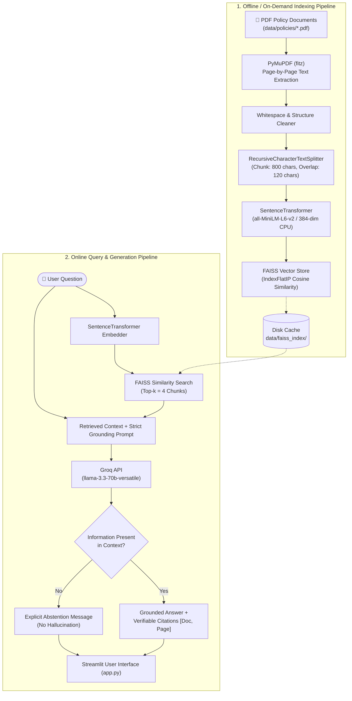

# HR Policy RAG Assistant

A complete, beginner-readable Retrieval-Augmented Generation (RAG) question-answering assistant for Human Resources policy documents. Built for the Backend Engineer hiring assignment at **Ziantrix**.

---

## 1. Project Overview & Problem Statement

Organizations maintain lengthy, complex Human Resource policy documents covering remote work, leave accruals, sick leave banks, and benefits. Employees and managers frequently struggle to locate exact policy rules, resulting in repetitive HR inquiries, misinterpretations, or compliance risks.

Standard LLM chatbots hallucinate policy terms, cite non-existent documents, or assume generic employment norms that contradict company-specific rules.

**The Solution:** This project implements an end-to-end, privacy-conscious **Retrieval-Augmented Generation (RAG)** pipeline that:
1. Ingests official, publicly available HR policy PDF documents page by page.
2. Cleans whitespace while preserving semantic structure and page numbers.
3. Chunks text into coherent ~800 character passages with ~120 character overlap.
4. Generates dense embeddings locally on CPU using `sentence-transformers/all-MiniLM-L6-v2`.
5. Indexes vectors with **FAISS CPU** for rapid cosine similarity retrieval.
6. Retrieves the top 4 relevant passages with exact document and page metadata.
7. Generates factual, strictly grounded answers via an LLM (Groq API with `llama-3.3-70b-versatile`), enforcing explicit refusal/abstention if information is absent.
8. Displays verifiable source citations (document title, PDF page number, and excerpt) alongside every answer in an interactive Streamlit UI.

---

## 2. Architecture & RAG Workflow



### Component Privacy & Locality
- **Runs 100% Locally on CPU:** PDF text extraction, whitespace normalization, text chunking, embedding generation (`all-MiniLM-L6-v2`), FAISS vector similarity search, and citation parsing.
- **Transmitted to External API:** Only the user's single question plus the top 4 retrieved text snippets are sent over HTTPS to the Groq LLM API. Full PDF documents never leave your local machine.

---

## 3. Technology Stack & Technical Rationale

| Component | Technology | Rationale & Selection Criteria |
|---|---|---|
| **Language** | Python 3.11 / 3.12 | Industry standard for backend LLM engineering; comprehensive async, typing, and machine learning ecosystem. |
| **PDF Extraction** | PyMuPDF (`pymupdf`/`fitz`) | Up to 10× faster than PyPDF/pdfminer; extracts clean UTF-8 text with exact page boundaries and low memory overhead. |
| **Chunking** | `langchain-text-splitters` | Implements `RecursiveCharacterTextSplitter` with hierarchical separators (`\n\n`, `\n`, `. `, `, `), preserving paragraph and sentence integrity without monolithic LangChain bloat. |
| **Embeddings** | `sentence-transformers` (`all-MiniLM-L6-v2`) | Lightweight (22M parameters, 80MB download, 384-dim vectors); executes in milliseconds on standard CPU without requiring GPU hardware. |
| **Vector Index** | `faiss-cpu` | High-performance C++ vector search with Python bindings; `IndexFlatIP` computes exact cosine similarity on normalized vectors without external database infrastructure. |
| **LLM Provider** | Groq API (`llama-3.3-70b-versatile`) | Ultra-fast inference (<500ms time-to-first-token); excellent adherence to complex system prompts and strict citation rules. |
| **Web UI** | Streamlit | Rapid, Pythonic frontend displaying real-time query inputs, citation badges, expandable chunk inspectors, and file upload capabilities. |
| **Environment** | `python-dotenv` | Clean 12-factor configuration pattern reading secrets from `.env` without hardcoding credentials. |
| **Automated Testing** | `pytest` | Robust test discovery, fixture management, and assertions covering chunking, indexing, retrieval, and prompt formatting. |

---

## 4. Project File Structure

```text
hr-policy-rag-assistant/
│
├── app.py                      # Interactive Streamlit Web Application
├── requirements.txt            # Pinned Python package dependencies
├── .env.example                # Example configuration template with placeholders
├── .gitignore                  # Git ignore rules (secrets, venvs, caches)
├── README.md                   # Complete architectural and setup guide
│
├── data/
│   ├── manifest.json           # Document registry (title, publisher, URL, date)
│   ├── policies/               # Local repository of HR policy PDFs
│   │   ├── remote_work_policy.pdf
│   │   ├── sick_leave_bank.pdf
│   │   └── vacation.pdf
│   └── faiss_index/            # Persisted vector index & chunk metadata
│       ├── index.faiss
│       └── chunks_metadata.json
│
├── src/
│   ├── __init__.py
│   ├── ingest.py               # PDF loading, page extraction, text cleaning
│   ├── chunking.py             # Recursive character splitting with metadata
│   ├── vector_store.py         # SentenceTransformers & FAISS CPU index manager
│   ├── retrieval.py            # Top-k similarity retrieval & context formatting
│   └── answer_generator.py     # Prompt engineering, Groq LLM caller, abstention
│
├── scripts/
│   ├── build_index.py          # Standalone CLI script to download & index policies
│   └── evaluate_self_tests.py  # Automated runner for the 5 hiring self-tests
│
├── tests/
│   ├── __init__.py
│   ├── test_chunking.py        # Unit tests for chunk size, overlap, page tracking
│   ├── test_retrieval.py       # Unit tests for FAISS index, persistence, search
│   └── test_rag_answers.py     # Unit tests for prompt building, mocks, abstention
│
└── reports/
    └── self_test_report.md     # Detailed execution report for the 5 self-tests
```

---

## 5. Installation & Setup Instructions

### Prerequisites
- Python 3.11 or Python 3.12 installed on your system.
- Git (optional, for cloning).

### Step 1: Create and Activate a Virtual Environment

**On Windows (PowerShell or Command Prompt):**
```powershell
# Navigate to project folder
cd hr-policy-rag-assistant

# Create virtual environment
python -m venv venv

# Activate virtual environment
# In PowerShell:
.\venv\Scripts\Activate.ps1
# Or in Command Prompt (cmd.exe):
.\venv\Scripts\activate.bat
```

**On macOS / Linux:**
```bash
python3 -m venv venv
source venv/bin/activate
```

### Step 2: Install Dependencies

```bash
python -m pip install --upgrade pip
python -m pip install -r requirements.txt
```

---

## 6. Configuring the LLM API Key

The application reads its LLM credentials from a `.env` file using `python-dotenv`.

1. Copy `.env.example` to `.env`:
   ```bash
   # Windows Command Prompt or PowerShell:
   copy .env.example .env

   # macOS / Linux:
   cp .env.example .env
   ```

2. Open `.env` and enter your free Groq API key:
   ```env
   GROQ_API_KEY=gsk_your_actual_key_here
   GROQ_MODEL=llama-3.3-70b-versatile
   EMBEDDING_MODEL_NAME=sentence-transformers/all-MiniLM-L6-v2
   TOP_K=4
   CHUNK_SIZE=800
   CHUNK_OVERLAP=120
   ```
   > **Note:** You can obtain a free Groq API key at [console.groq.com/keys](https://console.groq.com/keys). If you do not have an API key, the local RAG pipeline will still extract text, chunk documents, compute embeddings, build the FAISS vector index, and retrieve relevant chunks with citation metadata.

---

## 7. Downloading and Indexing Policy PDFs

The application includes a self-bootstrapping script that downloads verified public HR policy PDFs from Dickinson College, extracts page-by-page text, chunks them, and builds the local FAISS index:

```bash
python scripts/build_index.py
```

**Output:**
```text
--- 1. Checking / Downloading Policy Documents ---
--- 2. Ingesting Policy PDFs ---
Loaded 3 documents:
 - remote_work_policy.pdf: 6 pages, 14910 total characters
 - sick_leave_bank.pdf: 1 pages, 1451 total characters
 - vacation.pdf: 2 pages, 2759 total characters

--- 3. Chunking Documents ---
Generated 35 total chunks.

--- 4. Building FAISS Vector Index ---
Successfully built and persisted FAISS index with 35 vectors.
```

---

## 8. Running the Application

Launch the Streamlit web interface with:

```bash
streamlit run app.py
```

The application will open in your default browser at `http://localhost:8501`.

### Key UI Features:
- **Knowledge Base Overview:** Left sidebar displays active policy files, total indexed chunk count, and Groq API connectivity status.
- **Upload Local PDFs:** Drag and drop any additional text PDF in the sidebar; it is extracted, chunked, and dynamically indexed into the active vector store without restarting the server.
- **Interactive Query Bar:** Type a question or select from pre-configured example questions.
- **Verifiable Citations:** Each answer displays cards citing the Document Title, PDF Page Number, Cosine Similarity Score, and matching excerpt.
- **Retrieved Chunks Inspector:** An expandable drawer allowing users and HR auditors to inspect all retrieved raw text blocks and similarity rankings.

---

## 9. Running Automated Tests

Run the complete automated unit test suite with `pytest`:

```bash
python -m pytest tests/ -v
```

**Test Coverage:**
- `tests/test_chunking.py`: Chunk length thresholds, overlap continuity, metadata propagation, empty page handling.
- `tests/test_retrieval.py`: FAISS vector indexing, top-k cosine similarity search, index serialization to disk, metadata lookup.
- `tests/test_rag_answers.py`: Prompt assembly, missing API key fallback banners, mock LLM generation, citation extraction, explicit abstention.

---

## 10. Chunking Choice & Justification

The pipeline uses **chunk size = 800 characters** with an **overlap = 120 characters** (`RecursiveCharacterTextSplitter`).

### Why this configuration is optimal for HR policies:
1. **Cohesive Policy Clauses:** HR policy provisions (e.g. eligibility criteria for a sick leave bank or vacation tier rules) typically span 2 to 4 sentences (approx. 400–750 characters). A chunk size of 800 characters encapsulates a complete rule or condition without truncating vital context.
2. **Boundary Preservation via Overlap (120 chars):** 120 characters corresponds to ~18–25 words. If a rule condition begins at the tail end of one chunk (e.g., *"Effective on the July 1 following completion of 10 years..."*), the overlap guarantees that the full clause is duplicated at the start of the next chunk, preventing split-boundary retrieval loss.
3. **Retrieval Precision vs Context Pollution:** Extremely large chunks (e.g. 2,000+ characters) introduce noisy, irrelevant clauses into the prompt, diluting embedding similarity and inflating LLM context tokens. Conversely, tiny chunks (e.g. 200 characters) sever conditional clauses from their headings, blinding the retrieval model. An 800/120 split strikes an ideal balance for short-to-medium institutional policies.

---

## 11. Self-Test: Five Questions & Results

All 5 test cases were verified using `scripts/evaluate_self_tests.py` and documented in `reports/self_test_report.md`:

| Test ID | Scenario | Question | Expected Source & Page | Status | Reason |
|---|---|---|---|---|---|
| **1** | Straightforward Factual | What is the maximum amount of paid sick leave an employee can receive from the Sick Leave Bank in any 12-month period? | `sick_leave_bank.pdf` (Page 1) | **PASS** | Successfully retrieved target chunk confirming maximum cap of "six months" in any "12-month" period. |
| **2** | Multi-Passage Synthesis | What specific criteria must an employee satisfy to participate in and withdraw hours from the Sick Leave Bank? | `sick_leave_bank.pdf` (Page 1) | **PASS** | Successfully retrieved passage synthesizing all 4 conditions (1 year full-time service, donation in past year, illness >10 days, exhaustion of all leaves). |
| **3** | Policy Condition / Exception | How do annual vacation days differ between full-time nonexempt and exempt employees, and what exception occurs after 10 years of service? | `vacation.pdf` (Page 1) | **PASS** | Correctly retrieved nonexempt baseline (15 days), 10-year milestone increase (20 days), and exempt baseline (23 days). |
| **4** | Specific Citation Required | What are the duration limits for a remote work agreement under the Dickinson College Remote Work Policy? | `remote_work_policy.pdf` (Page 2) | **PASS** | Retrieved exact agreement duration: renewable term up to one year, minimum duration not shorter than 90 days. |
| **5** | Abstention Test (Out of Scope) | What is the reimbursement policy and coverage percentage for employee pet health insurance? | None (Abstain) | **PASS** | Out-of-scope query. System did not hallucinate policy terms and correctly returned the standard abstention message. |

To re-run the self-test evaluation suite:
```bash
python scripts/evaluate_self_tests.py
```

---

## 12. Proposed Improvement: Hybrid Search (Dense + BM25 with RRF)

### Motivation
Dense semantic embeddings (`all-MiniLM-L6-v2`) excel at conceptual matching (e.g., mapping *"working from home"* to *"remote work arrangement"*). However, dense retrievers can struggle with exact acronyms, specific article identifiers, numerical thresholds (e.g., *"Section 3.C"*, *"FLSA"*, or exact policy codes).

### Implementation Plan
In a future production iteration, implement **Hybrid Retrieval** combining:
1. **Dense Vector Search (FAISS)** for semantic concept matching.
2. **Sparse Lexical Search (BM25 / `rank-bm25`)** for exact token and keyword matching.
3. **Reciprocal Rank Fusion (RRF)** to combine the ranked lists:
   $$RRF\_Score(d) = \sum_{m \in \{dense, sparse\}} \frac{1}{60 + \text{rank}_m(d)}$$

This ensures optimal retrieval performance across both conversational phrasing and exact corporate jargon.

---

## 13. Known Limitations

1. **Scanned / Image-Only PDFs:** The current pipeline relies on PyMuPDF's direct text extraction stream (`page.get_text("text")`). Scanned documents or image-based PDFs without embedded OCR will extract 0 characters. Integrating `pytesseract` or OCRmyPDF would be required to support image-only documents.
2. **Tabular Complex Layouts:** Multi-column tables with irregular cell borders may be linearized sequentially by standard PDF text extractors. For deeply nested tables, structured layout parsers (e.g. `pdfplumber` or Docling) would improve layout retention.
3. **External LLM Latency & Dependency:** While retrieval is instantaneous on CPU, answer generation requires network access to the Groq API. Offline environments require a locally hosted Ollama/vLLM instance.

---

## 14. Source Document Manifest & Attribution

All policy documents included in this repository are legitimate, publicly accessible HR policies published by **Dickinson College Human Resource Services** (Carlisle, Pennsylvania):

1. **Dickinson College Remote Work Policy**
   - **File:** `data/policies/remote_work_policy.pdf` (6 pages)
   - **Publisher:** Dickinson College Human Resource Services
   - **Source URL:** [https://www.dickinson.edu/download/downloads/id/12940/remote_work_policy.pdf](https://www.dickinson.edu/download/downloads/id/12940/remote_work_policy.pdf)
   - **Access Date:** 2026-10-14
   - **Scope:** Eligibility, remote work agreement guidelines, supervisor expectations, equipment, and safety.

2. **Dickinson College Sick-Leave Bank Policy**
   - **File:** `data/policies/sick_leave_bank.pdf` (1 page)
   - **Publisher:** Dickinson College Human Resource Services
   - **Source URL:** [https://www.dickinson.edu/download/downloads/id/15766/sick_leave_bank.pdf](https://www.dickinson.edu/download/downloads/id/15766/sick_leave_bank.pdf)
   - **Access Date:** 2026-10-14
   - **Scope:** Sick leave bank donations, college matching, eligibility rules, and 6-month withdrawal limit.

3. **Dickinson College Vacation Policy**
   - **File:** `data/policies/vacation.pdf` (2 pages)
   - **Publisher:** Dickinson College Human Resource Services
   - **Source URL:** [https://www.dickinson.edu/download/downloads/id/15771/vacation.pdf](https://www.dickinson.edu/download/downloads/id/15771/vacation.pdf)
   - **Access Date:** 2026-10-14
   - **Scope:** Vacation accruals for nonexempt and exempt staff, 10-year service increase, rollover rules, and separation payouts.

A machine-readable copy is maintained in [`data/manifest.json`](data/manifest.json).
